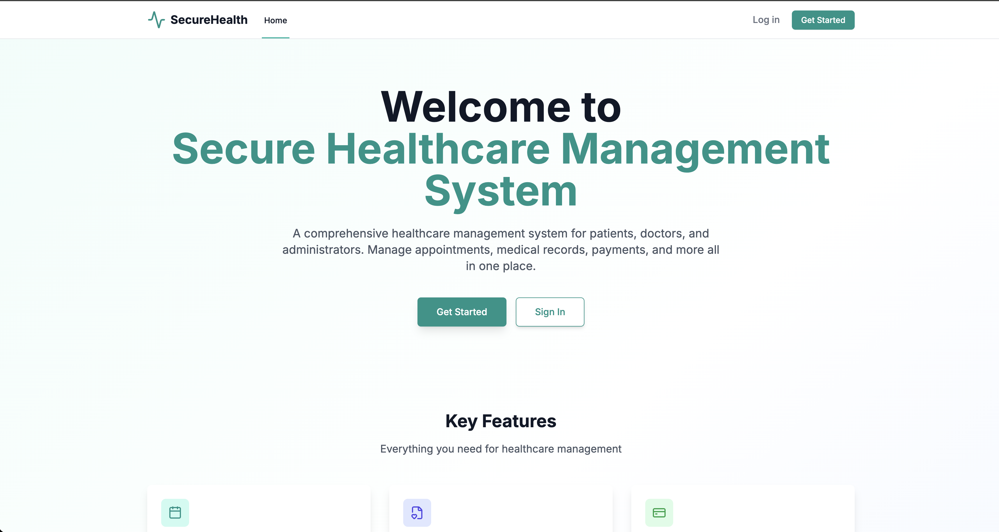

# Vulnerable Healthcare Application (VHA)

A premium-designed, intentionally vulnerable healthcare management system built with FastAPI, PostgreSQL, and TailwindCSS.



## 🚀 Features
- **User Management**: Auth, Roles, Profiles, Avatars.
- **Patient Portal**: Appointments, Medical Records (Import/Export).
- **Billing**: Invoices, Payment Processing.
- **Admin**: Diagnostics, Logs, User Search.
- **Security Training**: 30+ vulnerabilities spanning OWASP Top 10.

## 🛠️ Setup
1. **Docker (Recommended)**
   ```bash
   docker compose up -d --build
   ```
   Access at `http://localhost:8000`

2. **Manual** (Requires PostgreSQL)
   ```bash
   pip install -r requirements.txt
   uvicorn backend.app.main:app --reload
   ```

## 🔐 Credentials
- **Admin**: `admin@healthcare.com` / `admin123` (or use SQLi)
- **Doctor**: `drsmith@healthcare.com` / `doctor123`
- **Patient**: `jdoe@healthcare.com` / `patient123`

## 📚 Documentation
- [Vulnerability List](VULNERABILITY_LIST.md): Detailed list of all 32+ flaws and how to exploit them.

## ⚠️ Disclaimer
**FOR EDUCATIONAL PURPOSES ONLY.** Do not run this on public-facing servers.
